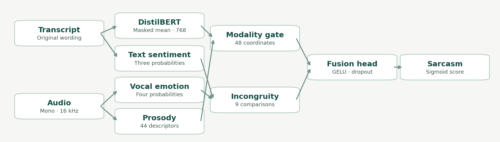
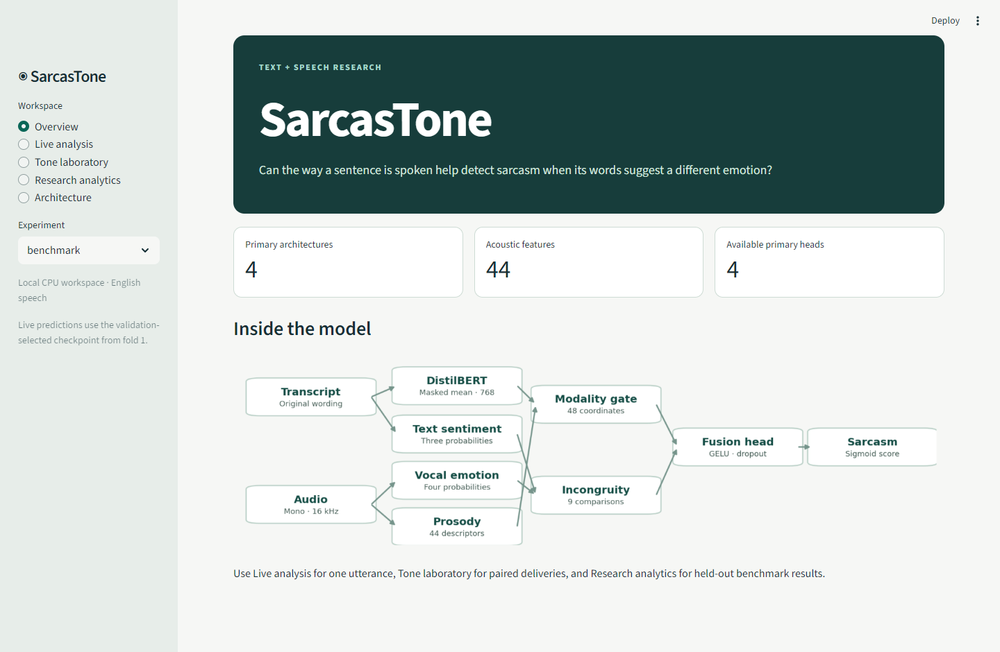

# SarcasTone
## Multimodal sarcasm detection using text and speech prosody

SarcasTone is a local research application for asking a specific question: when a speaker's delivery conflicts with the apparent sentiment of their words, does adding prosody help classify sarcasm? Record a sentence, edit the transcript, and compare four trained classifiers on the same input. The tone laboratory holds the words constant while two real recordings vary the delivery.

### Measured outcome

All 690 real utterances were evaluated out of fold. Mean binary F1 was **0.669** for the proposed model, **0.675** for concatenation, **0.673** for speech alone and **0.652** for text alone. On the 97 out-of-fold utterances with opposite predicted valences, pooled F1 was **0.523** for the proposed head and **0.587** for text alone. This experiment provides no evidence of an advantage for the full incongruity head in that subset. The Friends holdout produced a different ranking. [All baselines, ablations and subgroups](research/BENCHMARK.md) · [Verification and timings](research/VERIFICATION.md)

### Start on Windows

Open this repository folder in VS Code. The commands below use 64-bit Python 3.10 and PowerShell. The default permanent storage root is `D:\SarcasTone`. Set `SARCASTONE_HOME` or change `configs/default.yaml` before setup to choose a different drive. Use the same storage value in every terminal and app launch. A copy of the source can also live under that drive.

~~~powershell
$env:SARCASTONE_HOME = 'D:\SarcasTone'
.\scripts\setup_environment.ps1 -Storage $env:SARCASTONE_HOME
$py = "$env:SARCASTONE_HOME\environment\venv\Scripts\python.exe"
& $py -m sarcastone setup
& $py -m sarcastone verify
& $py -m sarcastone pipeline --run benchmark
& $py -m sarcastone train --protocol friends --run friends
& $py -m sarcastone report --run friends
.\scripts\launch_app.ps1 -Storage $env:SARCASTONE_HOME
~~~

In VS Code choose **Python: Select Interpreter → Enter interpreter path**, then select the executable assigned to `$py`. If script execution is restricted, run the script in a process-scoped PowerShell session permitted by your system policy. With the environment already installed, launch directly with `& $py -m streamlit run app.py`. Open **http://localhost:8501**. The launch script binds only to localhost.

**Storage budget.** The official media ZIP is 1,403,183,019 bytes. The four model directories require about 1.22 GB in total. Reserve 8–10 GB for the archive, derived WAVs, package cache, environment, checkpoints and temporary files. Exact footprint depends on the installed wheels and number of experiments. See `research/VERIFICATION.md` for this installation's measurements. Downloads, pip cache and install temporary files use the selected drive. Once setup succeeds, normal operation uses local paths and offline loaders.

### Obtain or recover resources

The publisher links the raw ZIP from the [MUStARD repository](https://github.com/soujanyaporia/MUStARD). The [official raw archive](https://huggingface.co/datasets/MichiganNLP/MUStARD/resolve/main/mmsd_raw_data.zip) includes target and context videos. Keep the original ZIP. For a manual import:

~~~powershell
& $py -m sarcastone setup --archive 'E:\Downloads\mmsd_raw_data.zip'
& $py -m sarcastone verify
~~~

Setup fetches the primary JSON, the published fold file, the MUStARD++ CSV and the exact model files in the two lockfiles. The lightweight metadata-only option is `setup --metadata-only`. Existing files are checked by length and upstream digest before any request. Incomplete binary transfers remain as `.part` files. A retry uses an HTTP Range request and restarts only that file when the source ignores ranges. A corrupt complete file fails the checksum. For an unresolvable hash mismatch, keep your existing files and verify the revision against the publisher before updating the lock. A network interruption during pip installation can require retrying a wheel. Completed pip downloads stay cached.

**Offline operation.** Finish package installation and resource setup once online. Disconnect, run `verify`, then train or launch. The explicit `setup` command is the only project stage that fetches research resources. Hugging Face loaders use local paths, disabled remote code and offline flags. A unified run first validates every required asset. Run setup again to supply missing assets.

### Reproduce or resume stages

~~~powershell
& $py -m sarcastone prepare
& $py -m sarcastone extract
& $py -m sarcastone train --run benchmark --models tfidf svm text speech concat
& $py -m sarcastone train --run benchmark --models proposed
& $py -m sarcastone train --run benchmark
& $py -m sarcastone evaluate --run benchmark
& $py -m sarcastone report --run benchmark
& $py -m sarcastone resume --run benchmark
~~~

`extract` resumes at the next missing or invalid sample per branch. `train` resumes from an epoch boundary and skips completed model/fold results. `resume` verifies resources, rechecks preprocessing, fills missing caches, completes training and rebuilds reports. `extract --force-recompute` and `prepare --force-recompute` explicitly regenerate derived artifacts. To repeat a finished training run, supply a new `--run` name. The run manifest guards against changing the protocol, feature configuration or hyperparameters under an existing name.

**Other experiments.** Use `train --protocol speaker --run speaker-cv` for five folds grouped by speaker and duplicates. `train --run auxiliary --models aux_emotion` adds a training-only auxiliary loss using verified MUStARD++ surface-emotion matches. Missing labels are masked. To test conversational context, copy the config, change `features.context` to true, then pass `--config path/to/context.yaml` to extract and train using a fresh run name. The context model appends the last two preceding turns to the target for its semantic embedding. Target tokens come first so truncation preserves the utterance. Context-linked splits group repeated target/context lines. The live app uses the target-only configuration. Context grouping may be restrictive if many dialogue components share short expressions.

### Data and usage

MUStARD contains 690 English-language television utterances, 345 per sarcasm class. The primary JSON maps IDs to target text, speaker, show, chronological context and binary label. The preparer maps each ID only to a member directly under `utterances_final`, decodes its audio track, and never extracts a ZIP path onto disk. It ignores context videos and all visual streams. The original archive remains intact. Mono 16 kHz float PCM preserves within-clip amplitude variation. Missing, ambiguous, invalid or silent media are exposed in the audit or fail validation. A filename match establishes publisher pairing. It cannot independently certify word-by-word timing, speaker purity or correctness of the transcript. [Dataset](https://github.com/soujanyaporia/MUStARD) · [Paper](https://aclanthology.org/P19-1455/)

MUStARD++ expands the corpus to 1,202 labeled targets. Its CSV also contains context rows. Target selection uses the annotated sarcasm field. A verified join requires agreement on scene ID, normalized target wording, speaker, show and label. Surface and implicit emotion plus overall valence are available. Neither overall valence nor surface emotion is a modality-specific literal-text sentiment label. The manifest keeps the missing sentiment field null. No extension sample enlarges the primary training set. The extension repository links videos on Google Drive, which this project does not require. [Authors' repository](https://github.com/cfiltnlp/MUStARD_Plus_Plus) · [Corpus paper](https://aclanthology.org/2022.lrec-1.756/)

The MUStARD repository carries an MIT license. Television footage has separate rights holders. The MUStARD++ repository inspected does not publish a standalone license for unrestricted redistribution. Obtain source material from the publishers, cite both datasets and verify permissions before redistributing clips or annotations. The source folder excludes all media, model weights and private recordings.

### Features, predictions and interpretation

| Branch | Local implementation | Output |
|---|---|---|
| Semantic | Frozen cased DistilBERT, original punctuation and negation, masked mean of final token states | 768 values |
| Sentiment | CardiffNLP Twitter RoBERTa sentiment model, trained for English social-media sentiment | Negative, neutral, positive |
| Vocal emotion | Frozen SUPERB wav2vec 2.0 emotion classifier, trained on IEMOCAP dialogue | Neutral, happy, angry, sad |
| Acoustics | SciPy FFT, autocorrelation, mel filterbank, DCT and signal summaries | 44 values |
| Transcription | Faster-Whisper Tiny English, CTranslate2 INT8 on CPU, greedy decoding | Editable text |

Masked mean pooling summarizes the target sequence without counting padding. The acoustic path uses 40 ms frames every 10 ms. A normalized autocorrelation peak estimates F0 in roughly 60–500 Hz. Unvoiced frames leave gaps in the plotted contour. A fully unvoiced sample has zero pitch summaries accompanied by its voiced fraction. The energy floor is 10% of the clip's 90th-percentile frame RMS, with a small absolute floor. Low-energy runs of at least 120 ms estimate pauses, including edge silence. Voicing, speech activity, adjacent pitch changes and energy changes are proxies. They can respond to music, compression or laughter. Thirteen nonzero MFCCs each supply a mean and standard deviation. Pitch, energy, timing and spectral summaries supply the other 18 values. Speech-only training consumes just this vector. Transcript word rate is excluded.

The semantic and acoustic MLPs project into 48 dimensions. A text-only MLP and a speech-only MLP test individual modalities. The concatenation head receives both projections without a gate or explicit emotion features. The proposed head uses the coordinate-wise operation `g = sigmoid(W[T,A]+b)`, followed by `F = g*T + (1-g)*A`. Vocal probabilities map to three valence masses in the order negative (angry + sad), neutral, positive (happy). Nine conflict features comprise three absolute gaps, three element-wise products, cosine distance and two directional cross-products. The final MLP receives the fused vector and these nine values. It learns a binary logit with BCEWithLogitsLoss. Conflict can raise or lower the learned score. Emotion probabilities describe classifier outputs, not a speaker's inner state.

The live explanations measure the change in score after substituting training means for groups of normalized inputs or zeroing the conflict vector. Correlated groups, off-distribution interventions and the arbitrary baseline limit interpretation. A gate is an internal mixing coefficient. Mean gate values alone cannot establish causal importance. [DistilBERT](https://arxiv.org/abs/1910.01108) · [Sentiment model](https://huggingface.co/cardiffnlp/twitter-roberta-base-sentiment-latest) · [Vocal model](https://huggingface.co/superb/wav2vec2-base-superb-er)

### Experimental protocol

The five official outer test sets are stored as JSON IDs converted from the authors' actual `data/split_indices.p` (the upstream README misspells the filename). Original JSON insertion order defines the indices. The official speaker-independent code tests on FRIENDS even though one comment names a different show. SarcasTone keeps all official test IDs where paired media validate, groups identical normalized utterances and identical PCM, and purges overlapping development records. It reserves an inner group-aware validation fold. The Friends protocol additionally removes shared named/generic speaker strings from development and groups speakers in validation. This is a stricter development partition than the original SVM setting. The five official folds measure mixed-speaker performance. [Upstream implementation](https://raw.githubusercontent.com/soujanyaporia/MUStARD/master/data_loader.py)

All models reuse saved IDs. Frozen per-utterance transforms can be cached before splitting. TF-IDF vocabulary, audio/text scaling, neural updates and auxiliary class inventory are fitted on training rows only. AdamW, a validation-F1 plateau scheduler, dropout and early stopping operate on small heads. Every epoch saves current and best weights, optimizer, scheduler, history, patience and RNG state. A previous generation survives atomic replacement. The binary decision threshold is fixed at 0.50. Hyperparameters are fixed across ablations. Scores are uncalibrated. Classical references use TF-IDF/logistic regression and a scaled RBF SVM with training-only internal probability estimation.

Ablations cover gate-only, conflict features with concatenation, sentiment removed, emotion removed and separate acoustic-group removal. The affect-removal conditions zero one probability vector before deriving conflict features. Fold summaries report mean and sample SD, binary and macro F1, the authors' weighted F1, accuracy, precision, recall and ROC-AUC. Each held-out score and confusion matrix is saved. Predicted agreement, opposite-valence and neutral-mismatch subsets carry their denominators. Human-annotated modality-specific valence pairs are unavailable. These exploratory subgroups are conditioned on imperfect classifiers. See `research/BENCHMARK.md` for measured results.

### Use the demonstration

1. Open **Live analysis**, choose **Multimodal** and **Microphone**. Allow browser microphone access on localhost. Record a short English sentence and stop.
2. Listen to the clip. Review the local automatic transcript, edit recognition errors and click **Analyze utterance**. Text-only and speech-only modes accept the corresponding inputs independently.
3. In **Tone laboratory**, leave **Lock both transcripts** enabled. Enter one sentence, such as “That is exactly what I needed.” Record an ordinary delivery in A and a sarcastic delivery in B. Click **Compare recordings**. Examine the actual score difference, contours, sentiment, vocal emotion and coordinate gate summaries. A same-label outcome is a valid result.
4. Use **Research analytics** to compare models and inspect real mistakes. Choose an experiment before seeing its scores. The live model always uses fold 1's validation-selected checkpoint to avoid choosing the best test fold.
5. For a separate human study, use the consent form below Live analysis after recording. Save speaker aliases, intended delivery, recording conditions, paired sentence IDs, self-described accent and literal sentiment. Run `& $py -m sarcastone external --run benchmark` only after freezing the model. Keep all study files under private storage. Report all attempts and never tune on them.

### Storage and code map

~~~text
project/
  app.py                      five-page Streamlit workbench
  configs/                    CPU defaults, pinned hashes, official fold IDs
  sarcastone/
    core.py, resources.py     storage, atomic persistence, downloads
    data.py, audio.py         annotation join, validation, signal processing
    features.py, splits.py    frozen encoders, per-sample cache, leakage checks
    model.py, training.py     six fusion conditions, auxiliary task, recovery
    experiments.py            classical references and comparable fold runs
    evaluation.py, report.py  predictions, curves, subgroup and error reports
    inference.py, external.py local deployment and consented held-out study
  scripts/                    Windows setup, launch, figures and paper export
  notebooks/                  optional Colab / Drive workflow
  research/                   diagrams, presentation, paper, QA and results
  tests/                      isolated synthetic regression fixtures
D:/SarcasTone/
  datasets/{archives,raw,processed}
  pretrained_models/<branch>/<revision>
  feature_cache/<branch>/<configuration>/<sample-input-hash>.npz
  results/<run>/fold-<index>/<model>/{best,latest,previous,inference}.pt
  environment/{venv,pip-cache,hf,torch,temp}
  private/{recordings,evaluations}
~~~

Checkpoints live beside their fold's evaluation to keep weights, normalization and held-out IDs together. Each cache path combines the sample ID, content fingerprint and branch-specific feature settings. Checks include ZIP CRC, array shape, dtype, finiteness and probability sums. Valid files survive interruption and changes to other branches. The normal training loop reads a small matrix of cached vectors into RAM and never executes a frozen encoder. Feature timing files record only newly computed vectors.

### Troubleshooting and verification

- **No model available** — run `verify`, then `pipeline`. Read the first missing path. Set the same storage root in the app and CLI.
- **Interrupted run** — rerun `resume --run benchmark`. A changed config or library version needs a new run directory. Do not rename older checkpoints into a new configuration.
- **Download interruption** — retry setup with the same root. Import the official ZIP using the manual command above. The download lock serializes writes.
- **Rejected recording** — record 0.12–45 seconds of audible sound. Check the OS default microphone, browser permission and input gain. Uploaded targets use the same FFmpeg decoder as captured audio. Very quiet or corrupted clips produce explicit errors.
- **Slow live processing** — keep recordings short. Each large classifier loads sequentially to constrain RAM. Report both ASR and analysis time. The publication charts distinguish classifier-only time from full inference.
- **No GPU** — default device is CPU with three Torch threads. `device: auto` can select CUDA in Colab. See the notebook for persistent Drive storage and feature-only training.
- **Tests** — run `& $py -m unittest discover -s tests -v`. Synthetic test fixtures never enter the benchmark. See the verification report for actual import, recovery, inference and application checks and the remaining physical-microphone procedure.

The dataset is small and draws from scripted English comedy. Speaker identity, laugh tracks, loudness, TV editing and transcript style can all predict labels without understanding intent. Private paired recordings test a different domain. Results on television alone do not establish reliability across accents, conversational settings or people.

### Research and presentation files

- [Editable Word paper](research/SarcasTone-paper.docx) and [PDF paper](research/SarcasTone-paper.pdf), with measured comparisons and numbered references
- [Viva questions and worked explanations](VIVA_GUIDE.md), [presentation sequence](research/PRESENTATION.md) and [optional Colab notebook](notebooks/colab.ipynb)
- [Tone laboratory screenshot](research/tone-laboratory.png) from two clearly identified uploads of “Really?” and [research analytics screenshot](research/analytics.png)

To regenerate the paper after an experiment, install the optional document helper and run the following commands. PDF export uses desktop Word on Windows. The editable document also supports ordinary PDF export from a compatible editor.

~~~powershell
& $py -m pip install python-docx==1.2.0
& $py scripts/publish_results.py
& $py scripts/export_paper.py --run "$env:SARCASTONE_HOME/results/benchmark" --holdout "$env:SARCASTONE_HOME/results/friends"
.\scripts\export_pdf.ps1
~~~
